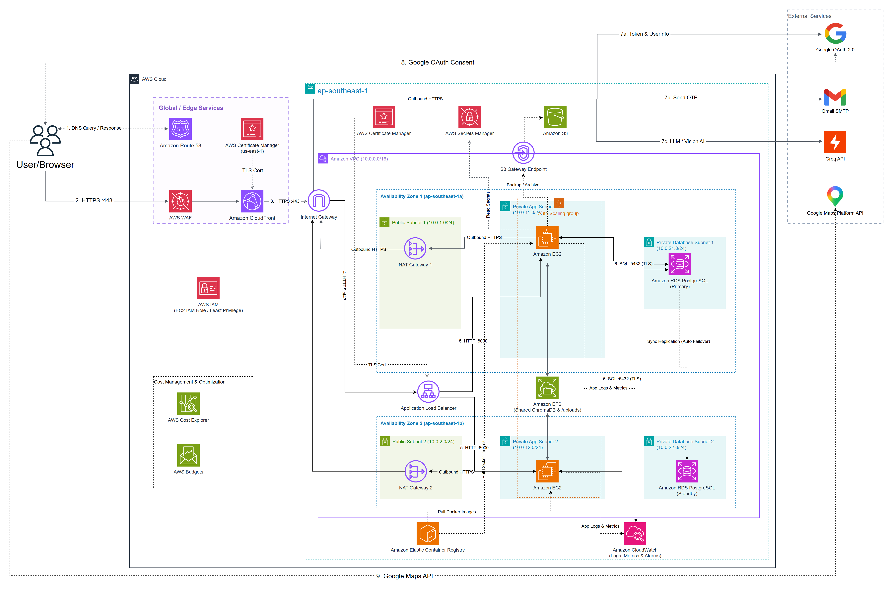
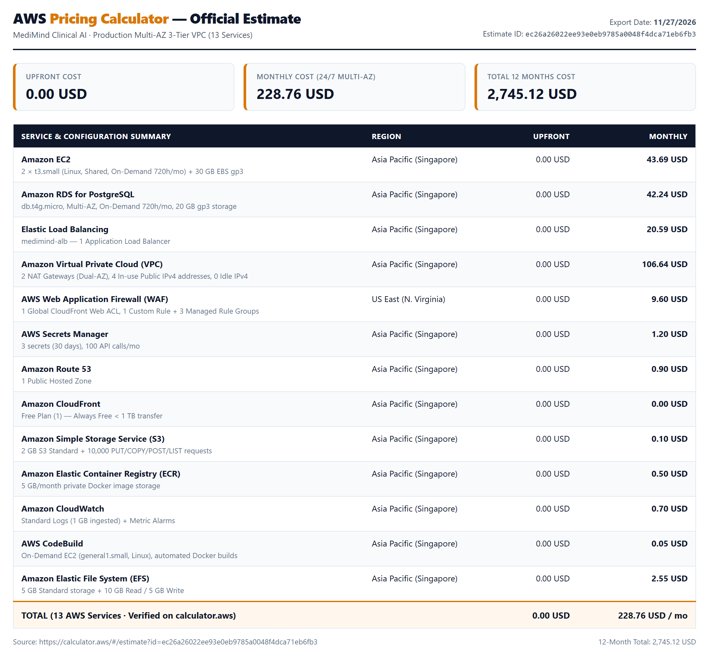

# Project Proposal: MediMind Clinical AI on AWS

> Concise executive proposal covering problem statement, preliminary AWS architecture, 12-week plan, cost estimation, and risk mitigation.

## 2.1. Executive Summary

MediMind Clinical AI is a digital clinical assistant helping patients screen symptoms safely, understand prescriptions accurately, and prepare pre-visit context—hosted on a secure, cost-efficient AWS architecture.

### 5 Proposed Core Capabilities

- **Safe Symptom Triage:** Classifies Green / Yellow / Red risk levels, triggers 115 emergency warnings early, and blocks unauthorized antibiotic prescribing.
- **Prescription OCR & Verification:** Extracts medication names and dosages, flags discrepancies for user review, and supports medication reminders.
- **Evidence-Based Medical RAG:** Grounds responses in 364 trusted clinical documents from MedlinePlus NIH and Ministry of Health guidelines.
- **Personalized Nutrition:** Computes BMR/TDEE from health profiles and filters allergies & conditions across 2,500 Vietnamese dishes (Mon Ngon Moi Ngay).
- **Pre-Visit Summary & Booking:** Generates concise pre-visit summaries, locates nearby clinics (2,144 facilities in HCMC & Hanoi), and books appointments.

## 2.2. Problem Statement

The proposal addresses four recurring bottlenecks in home healthcare and frontline consultations:

- **Frontline Overload:** Patients arrive without structured symptom history, extending intake times at clinics.
- **Unverified Online Search Risks:** Scattered health advice leads to missed red-flag emergencies or unsafe self-medication.
- **Prescription Misinterpretation:** Abbreviated prescriptions frequently cause dosing errors or missed doses among older and chronic-care patients.
- **Fragmented Patient Experience:** Symptom lookup, therapeutic nutrition, and clinic booking remain siloed across separate apps.

## 2.3. Objectives & Scope

Designed to balance clinical safety for end users with AWS Well-Architected best practices under an internship-friendly budget.

### Core Objectives

- Reliably detect emergency red flags (115) and enforce safe AI outputs.
- Deploy a live, HTTPS-secured, scalable AWS web platform.
- Protect user health data via private subnets, encryption, and zero hardcoded secrets.
- Keep demo cloud spend controlled under a hard $20 AWS Budgets alert.

### Project Scope

- **In Scope:** Full 5-module bilingual (VI/EN) web app, Google OAuth / OTP sign-in, Multi-AZ AWS infrastructure, and step-by-step Workshop documentation.
- **Out of Scope:** Does not replace licensed medical diagnosis or prescriptions; direct hospital HIS / HL7 FHIR integration is deferred to future phases.

## 2.4. Preliminary AWS Solution Architecture

Built on a 3-tier isolated VPC (Public – Private App – Private DB) spanning two Availability Zones in Singapore (ap-southeast-1):

### Overview of the 4 Core Layers

- **Edge & Security:** Amazon CloudFront delivers global HTTPS protected by AWS WAF (OWASP/SQLi/Rate Limit); Route 53 & ACM are planned for custom domain production.
- **Application Tier (Multi-AZ):** Application Load Balancer distributes traffic to Private EC2 instances (Dual-AZ Auto Scaling Group, no Public IP) backed by shared Amazon EFS and Amazon ECR.
- **Data & Secrets Tier:** Amazon RDS for PostgreSQL isolated in Private DB Subnets; Amazon S3 (via S3 Gateway Endpoint) for backups; AWS Secrets Manager for credentials and API keys.
- **AI & Operations:** Outbound NAT Gateways reach Groq API (4-Key Pool Failover), Google OAuth, Gmail SMTP, and Google Maps; Amazon CloudWatch & AWS Budgets handle monitoring and cost control.

## 2.5. Implementation Plan & Timeline (12 Weeks)

Executed across four sequential milestones from architecture design to live AWS validation:

| Phase | Timeline | Key Focus |
| --- | --- | --- |
| 1. Discovery & Design | Weeks 1 – 3 | Problem scoping, 3-tier AWS architecture design, and curating medical, nutrition, and facility datasets. |
| 2. AI Core & OCR | Weeks 4 – 6 | Build clinical safety guardrails, citation-backed RAG retrieval, and prescription OCR pipeline. |
| 3. Web App & Security | Weeks 7 – 9 | Complete Nutrition, Map/Booking modules, Google OAuth/OTP authentication, and automated testing. |
| 4. AWS Deploy & Demo | Weeks 10 – 12 | Deploy Multi-AZ AWS stack, configure monitoring/budgets, finalize Workshop docs, and run live demo. |

## 2.6. Budget & AWS Cost Estimation (ap-southeast-1)

Transparent Singapore On-Demand estimation (ap-southeast-1), separating hands-on Workshop demo spend from 24/7 Multi-AZ Production:

- **Workshop Demo (~40h):** ~$16.86 / mo — Actual Nov spend through Nov 27 is $11.57 (under $20 Budget).
- **Live Stack (24/7):** $207.28 / mo — 2 EC2 + 2 NAT GW + Single-AZ RDS + EFS + WAF + CloudWatch.
- **Full Multi-AZ (Calculator):** $228.76 / mo — Includes Multi-AZ RDS Standby ($2,745.12 / yr · $0 upfront).

| Core Service Group | Demo (~40h) | Full Multi-AZ (24/7) |
| --- | --- | --- |
| Compute & Storage (2 EC2 t3.small, 30 GB EBS) | $0.00 – $3.17 | $43.69 |
| Database (RDS PostgreSQL Multi-AZ 20 GB) | $0.00 | $42.24 |
| Networking (1 ALB, 2 NAT GW, 4 IPv4) | $3.97 | $127.23 |
| Security & Edge (us-east-1 WAF, Secrets, Route 53, S3, ECR) | ~$9.72 | $12.30 |
| Shared Storage & Ops (5 GB EFS, CloudWatch, CodeBuild) | $0.00 | $3.30 |
| Free Tier (CloudFront Free Plan, ASG, S3 Endpoint, ACM, Budgets, Groq) | $0.00 | $0.00 |
| **Estimated Monthly Total** | **~$16.86 / month** | **$228.76 / month** |

- **Custom Domain Note (Route 53 & ACM):** Budgeted at $0.90/month for a production domain; the live Workshop uses CloudFront's built-in HTTPS domain to save domain purchase costs. [Open AWS Pricing Calculator](https://calculator.aws/#/estimate?id=ec26a26022ee93e0eb9785a0048f4dca71eb6fb3)

*Official AWS Pricing Calculator estimate (13 services · $228.76/month · $2,745.12/12 months) — Click to zoom*

## 2.7. Risk Management & Mitigation

Key clinical, operational, security, and cost risks addressed proactively in the design:

| Key Risk | Impact | Proposed Mitigation |
| --- | --- | --- |
| Inaccurate AI advice or missed emergency symptoms | High | Apply pre/post clinical safety guardrails, prioritize 115 emergency alerts, and ground answers in curated medical sources. |
| Blurry prescription photos or API rate limits (HTTP 429) | Medium | Use 4-key Groq API failover with automatic retries and mandatory user review before saving medications. |
| Health data exposure or leaked credentials | High | Isolate EC2 & RDS in Private Subnets, enforce Least-Privilege IAM Roles + Secrets Manager, and mask PII. |
| Single-AZ outage or unexpected cloud billing | Medium | Deploy Dual-AZ EC2 ASG & NAT Gateways, CloudWatch Alarms, and a $20 AWS Budgets threshold alert. |
