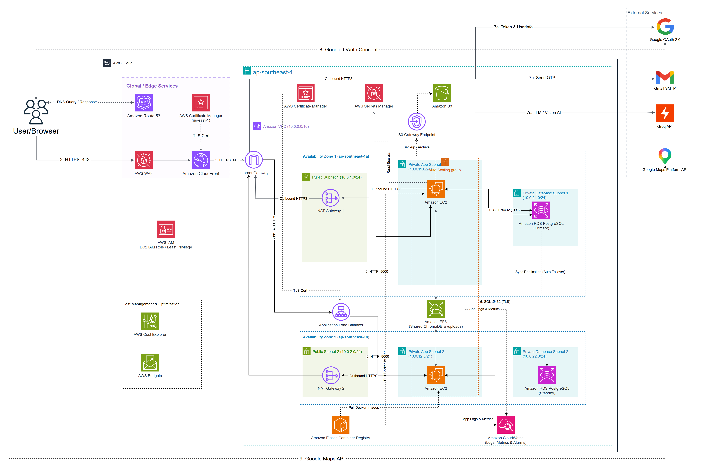
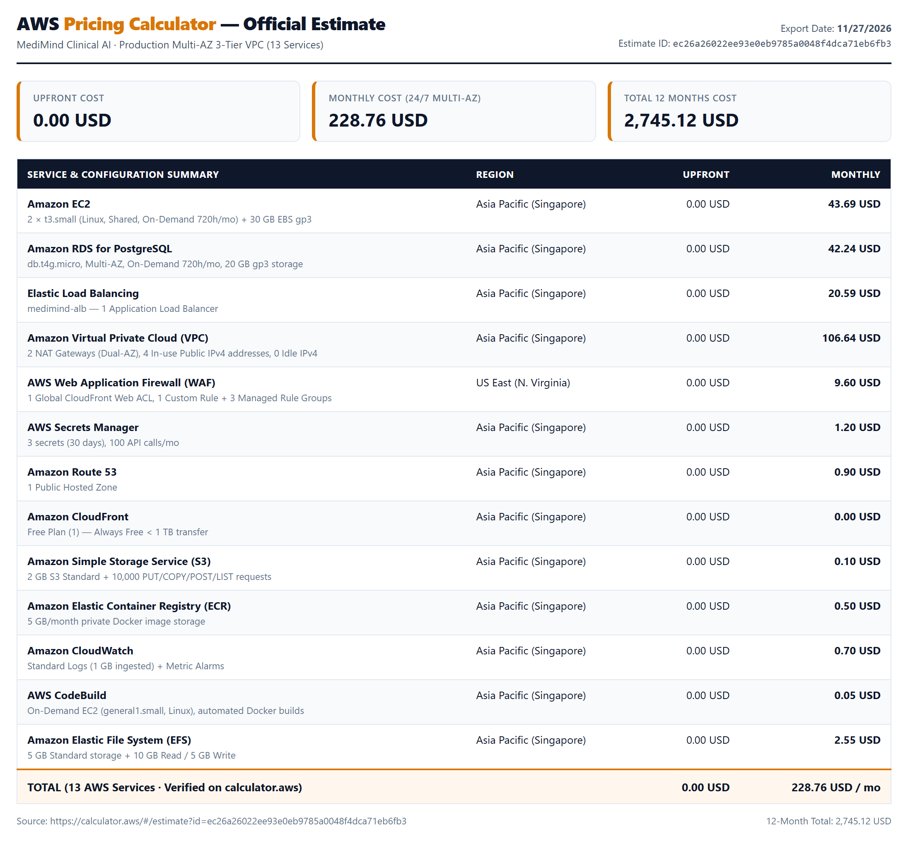

# Đề xuất Dự án: MediMind Clinical AI trên AWS

> Bản đề xuất tổng quan bài toán, kiến trúc AWS sơ bộ, lộ trình triển khai, dự toán chi phí và quản trị rủi ro.

## 2.1. Tổng quan Đề xuất (Executive Summary)

MediMind Clinical AI là nền tảng trợ lý y tế số hỗ trợ người dân sàng lọc triệu chứng sớm, đọc hiểu đơn thuốc an toàn và chuẩn bị thông tin trước khi thăm khám, vận hành trên hạ tầng AWS an toàn và tối ưu chi phí.

### 5 tính năng chính đề xuất

- **Sàng lọc triệu chứng an toàn:** Phân mức nguy cơ (Xanh – Vàng – Đỏ), phát hiện sớm dấu hiệu cấp cứu 115 và không tự ý kê đơn kháng sinh.
- **Quét & đối soát đơn thuốc (OCR):** Trích xuất tên thuốc, liều dùng, cảnh báo sai lệch cần người dùng xác nhận và hỗ trợ nhắc lịch uống thuốc.
- **Tra cứu y khoa có căn cứ (RAG):** Trả lời dựa trên 364 tài liệu chuẩn từ MedlinePlus NIH và hướng dẫn Bộ Y tế, giảm ảo giác AI.
- **Dinh dưỡng cá nhân hóa:** Tính chỉ số BMR/TDEE theo hồ sơ sức khỏe, lọc dị ứng và bệnh nền trên kho 2.500 món ăn Việt (Món Ngon Mỗi Ngày).
- **Hỗ trợ tiền khám & đặt lịch:** Tóm tắt bệnh sử gọn gàng, gợi ý cơ sở y tế gần nhất (2.144 cơ sở tại TP.HCM & Hà Nội) và đặt lịch hẹn.

## 2.2. Vấn đề Cần Giải quyết (Problem Statement)

Hệ thống tập trung tháo gỡ 4 nút thắt thực tiễn phổ biến trong chăm sóc sức khỏe tại nhà và khám chữa bệnh tuyến đầu:

- **Quá tải tuyến đầu:** Bệnh nhân thiếu công cụ sàng lọc ban đầu và chuẩn bị bệnh sử, làm kéo dài thời gian khai thác thông tin tại phòng khám.
- **Rủi ro tự tra cứu trên mạng:** Thông tin y tế rời rạc, thiếu kiểm chứng dễ khiến người bệnh bỏ lỡ dấu hiệu cấp cứu hoặc tự dùng sai thuốc.
- **Khó đọc hiểu đơn thuốc tại nhà:** Đơn thuốc viết tắt, nhiều thuốc dễ gây nhầm liều hoặc quên giờ uống ở người lớn tuổi và bệnh nhân mạn tính.
- **Trải nghiệm chăm sóc phân mảnh:** Tra cứu triệu chứng, theo dõi dinh dưỡng theo bệnh nền và đặt lịch khám hiện nằm rời rạc ở nhiều ứng dụng khác nhau.

## 2.3. Mục tiêu & Phạm vi Đề xuất (Objectives & Scope)

Đặt mục tiêu vừa đáp ứng an toàn y tế cho người dùng cuối, vừa chuẩn hóa kiến trúc đám mây theo AWS Well-Architected trong ngân sách sinh viên.

### Mục tiêu cốt lõi

- Nhận diện chính xác ca nguy cấp (115) và kiểm soát an toàn câu trả lời AI.
- Triển khai được hệ thống chạy live HTTPS ổn định, dễ mở rộng trên AWS.
- Đảm bảo bảo mật dữ liệu người dùng (cô lập mạng riêng, mã hóa, không lộ khóa).
- Tối ưu chi phí vận hành dưới ngưỡng kiểm soát AWS Budgets ($20 cho giai đoạn demo).

### Phạm vi thực hiện

- **Trong phạm vi:** Ứng dụng web hoàn chỉnh 5 phân hệ (song ngữ VI/EN), đăng nhập Google OAuth / OTP, triển khai hạ tầng AWS Multi-AZ và tài liệu Workshop.
- **Ngoài phạm vi:** Không thay thế chẩn đoán hay kê đơn của bác sĩ; chưa tích hợp trực tiếp hệ thống bệnh án điện tử bệnh viện (HIS/HL7 FHIR) ở giai đoạn này.

## 2.4. Kiến trúc Giải pháp Sơ bộ trên AWS (Preliminary Architecture)

Hệ thống được thiết kế theo mô hình VPC 3 tầng cô lập (Public – Private App – Private DB) trên 2 Availability Zones tại Singapore (ap-southeast-1):

### Tóm tắt 4 lớp kiến trúc chính

- **Lớp Biên mạng & Bảo mật:** Amazon CloudFront phân phối HTTPS toàn cầu kết hợp AWS WAF (chặn tấn công Web OWASP/SQLi/Rate Limit); dự kiến gắn Route 53 & ACM khi dùng tên miền thương hiệu riêng.
- **Lớp Ứng dụng (Multi-AZ):** Application Load Balancer chia tải vào cụm Amazon EC2 (Auto Scaling Group 2 AZ, nằm hoàn toàn trong Private Subnet, không Public IP) dùng chung Amazon EFS và kéo container từ Amazon ECR.
- **Lớp Dữ liệu & Bí mật:** Amazon RDS for PostgreSQL đặt trong Private DB Subnet tách biệt hoàn toàn với Internet; Amazon S3 (kèm S3 Gateway Endpoint) lưu sao lưu; AWS Secrets Manager quản lý tập trung khóa API & mật khẩu.
- **Lớp AI & Giám sát vận hành:** Kết nối ra ngoài qua NAT Gateway tới Groq API (4-Key Pool Failover), Google OAuth, Gmail SMTP và Google Maps; theo dõi tập trung bằng Amazon CloudWatch và kiểm soát chi phí với AWS Budgets.

## 2.5. Kế hoạch & Lộ trình Thực hiện (12 Tuần)

Lộ trình chia làm 4 giai đoạn nối tiếp từ thiết kế đến triển khai thực tế và nghiệm thu:

| Giai đoạn | Thời gian | Hạng mục trọng tâm |
| --- | --- | --- |
| 1. Khảo sát & Thiết kế | Tuần 1 – 3 | Phân tích bài toán, thiết kế kiến trúc AWS 3 tầng, chuẩn hóa dữ liệu y khoa, món ăn và cơ sở y tế. |
| 2. Xây dựng Lõi AI & OCR | Tuần 4 – 6 | Phát triển bộ lọc an toàn lâm sàng, tìm kiếm RAG có trích dẫn và tính năng đọc đơn thuốc OCR. |
| 3. Hoàn thiện Ứng dụng | Tuần 7 – 9 | Hoàn thiện phân hệ Dinh dưỡng, Bản đồ đặt lịch, xác thực Google OAuth/OTP và kiểm thử tự động. |
| 4. Triển khai AWS & Nghiệm thu | Tuần 10 – 12 | Triển khai hạ tầng AWS Multi-AZ, thiết lập giám sát/ngân sách, hoàn thiện Workshop và demo sản phẩm. |

## 2.6. Dự toán Ngân sách & Chi phí AWS (ap-southeast-1)

Ước tính chi phí minh bạch theo đơn giá Singapore (ap-southeast-1), tách rõ chi phí thực hành demo và chi phí vận hành Production 24/7:

- **Demo Workshop (~40h):** ~$16.86 / tháng — Thực chi tháng 11 đến 27/11 mới $11.57 (dưới ngưỡng Budget $20).
- **Live đang chạy (24/7):** $207.28 / tháng — 2 EC2 + 2 NAT GW + RDS Single-AZ + EFS + WAF + CloudWatch.
- **Full Multi-AZ (Calculator):** $228.76 / tháng — Bật thêm RDS Multi-AZ Standby ($2,745.12 / năm · Upfront $0).

| Nhóm dịch vụ chính | Demo (~40h) | Full Multi-AZ (24/7) |
| --- | --- | --- |
| Máy chủ & Lưu trữ (2 EC2 t3.small, 30 GB EBS) | $0.00 – $3.17 | $43.69 |
| Cơ sở dữ liệu (RDS PostgreSQL Multi-AZ 20 GB) | $0.00 | $42.24 |
| Mạng & Cân bằng tải (1 ALB, 2 NAT GW, 4 IPv4) | $3.97 | $127.23 |
| Bảo mật & Biên mạng (WAF us-east-1, Secrets, Route 53, S3, ECR) | ~$9.72 | $12.30 |
| Lưu trữ dùng chung & Vận hành (EFS 5 GB, CloudWatch, CodeBuild) | $0.00 | $3.30 |
| Miễn phí (CloudFront Free Plan, ASG, S3 Endpoint, ACM, Budgets, Groq) | $0.00 | $0.00 |
| **Tổng cộng ước tính** | **~$16.86 / tháng** | **$228.76 / tháng** |

- **Ghi chú tên miền (Route 53 & ACM):** Đã dự toán $0.90/tháng cho tên miền riêng ở bản Production; khi triển khai Workshop thực tế nhóm dùng sẵn tên miền HTTPS miễn phí của CloudFront. [Mở AWS Pricing Calculator](https://calculator.aws/#/estimate?id=ec26a26022ee93e0eb9785a0048f4dca71eb6fb3)

*Bảng dự toán chính thức AWS Pricing Calculator (13 dịch vụ · $228.76/tháng · $2,745.12/12 tháng) — Bấm để phóng to*

## 2.7. Quản trị Rủi ro & Phương án Giảm thiểu

Các rủi ro trọng yếu về an toàn y tế, vận hành và ngân sách đều được lên phương án phòng ngừa ngay từ khâu thiết kế:

| Rủi ro trọng yếu | Mức độ | Phương án giảm thiểu đề xuất |
| --- | --- | --- |
| AI trả lời thiếu chính xác hoặc bỏ sót ca cấp cứu | Cao | Áp dụng lớp kiểm duyệt an toàn trước/sau khi gọi AI, ưu tiên cảnh báo 115 và trích dẫn tài liệu y khoa chuẩn. |
| Ảnh đơn thuốc mờ hoặc quá tải API AI (HTTP 429) | Trung bình | Sử dụng cơ chế luân chuyển 4 khóa Groq API, tự động thử lại và yêu cầu người dùng xác nhận đơn thuốc. |
| Rò rỉ dữ liệu sức khỏe hoặc lộ khóa truy cập | Cao | Cô lập EC2 & RDS trong Private Subnets, dùng IAM Role + Secrets Manager, ẩn danh thông tin cá nhân. |
| Gián đoạn 1 vùng AZ hoặc phát sinh chi phí ngoài dự kiến | Trung bình | Thiết kế Multi-AZ (2 EC2 ASG, 2 NAT GW), thiết lập CloudWatch Alarms và cảnh báo AWS Budgets ngưỡng $20. |
